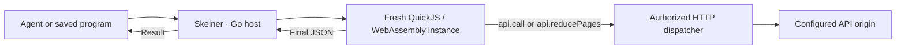

# Skeiner

Give your agent an OpenAPI spec. Let it write and rerun programs against your API.

Skeiner exposes two tools over the Model Context Protocol (MCP). With `search`, an agent discovers the operations you enabled and their inputs. With `execute`, it writes a short JavaScript program to read pages, join records, and return the answer it needs. You can save that program in Git and run it again from the CLI as the data changes.

For example, a program can ask *which pull requests have a published review and a failed required check on the current commit?* It can read every page and return just the matching PR, review, and check IDs. Skeiner handles HTTP and credentials in Go. Its binary includes the JavaScript runtime.

[Alpha release](https://github.com/hasit/skeiner/releases/tag/v0.1.0-alpha.1) · [Architecture](docs/architecture.md) · [Benchmarks](docs/benchmarks.md) · [OpenAPI support](docs/openapi.md)

## Run the offline quickstart

Extract the release archive for your platform and enter the extracted directory. The demo uses Python 3's standard library and a local snapshot of four historical exchange rates. It needs no API key or model.

```sh
python3 examples/rates/quickstart.py
```

The client starts Skeiner over MCP stdio, discovers two rate operations, and runs a saved program to compare ECB and blended EUR rates for GBP and USD on May 15, 2024. Only USD had a higher ECB rate.

```json
[{"date":"2024-05-15","quote":"USD","blended":1.0824,"ecb":1.0832}]
```

To build the same binary from source, use Go 1.25 or later. Then run the quickstart from the repository root.

```sh
git clone https://github.com/hasit/skeiner.git
cd skeiner
go build -o ./skeiner ./cmd/skeiner
python3 examples/rates/quickstart.py
```

For just the CLI, install the tagged Go module with `go install github.com/hasit/skeiner/cmd/skeiner@v0.1.0-alpha.1`.

## Rerun a saved program

The quickstart's JavaScript is a plain file. To rerun it against the public Frankfurter API, give Skeiner the spec, the origin, and the two allowed operations. The command prints one JSON value to stdout. [Comparison program](examples/rates/compare.js) · [Example spec](examples/rates/openapi.yaml)

```sh
./skeiner run --spec examples/rates/openapi.yaml \
  --base-url https://api.frankfurter.dev/v2 --token-env '' \
  --allow getRate,getProviderRate --mode async --program examples/rates/compare.js
```

## Connect an agent to your API

Start by inspecting which operations Skeiner can call. Replace the example values with your own API and supply its token in the host environment. Preflight checks the spec and configuration locally.

```sh
./skeiner preflight --spec ./openapi.yaml --base-url https://api.example.com/v1 \
  --token-env MY_API_TOKEN --allow listIncidents,getIncidentEvents
```

Register `serve` with a stdio-capable MCP client using the same arguments. Use absolute paths because the client chooses the server's working directory. Configure the client to pass the named token environment variable to the server process.

```json
{
  "mcpServers": {
    "skeiner": {
      "command": "/absolute/path/to/skeiner",
      "args": ["serve", "--spec", "/absolute/path/to/openapi.yaml",
               "--base-url", "https://api.example.com/v1",
               "--token-env", "MY_API_TOKEN",
               "--allow", "listIncidents,getIncidentEvents"]
    }
  }
}
```

With no allowlist configured, Skeiner exposes every supported named operation available under the configured credentials. This can include writes. For a read-only integration, select the intended operations explicitly. Repeated `--allow-get` flags also select GET routes by exact OpenAPI path template. [Authorization and supported OpenAPI features](docs/openapi.md)

## How a program runs



Each execution has a fresh guest, up to 16 sequential API calls and a 16 KiB JSON result. A program that needs more pages can return a compact accumulator and the next cursor, then resume in a new execution. The caller owns the checkpoint. [Architecture and execution sequence](docs/architecture.md) · [Program API, budgets and pagination](docs/sandbox.md)

## Benchmarks

The inventory benchmark scans 54 synthetic pull requests across six pages. Both paths use the same MCP server and find the same eight matching PRs, including their review and check IDs. The page-by-page client filters locally. The saved program filters inside Skeiner.

| Original snapshot | Page-by-page client | Saved program |
| --- | ---: | ---: |
| HTTP reads | 6 | 6 |
| MCP `execute` calls | 6 | 1 |
| JSON reply bytes returned to the client | 18,277 | 366 |

That is **98.0% fewer reply bytes** on this fixture. The benchmark reruns the same program after changing four records and checks both answers against expected IDs. It runs without a model. Model token use, answer latency, and cost depend on the client and workload. [Method, runtime timings and results](docs/benchmarks.md) · [Saved investigation](benchmarks/inventory/blocked.js)

```sh
go build -o ./skeiner ./cmd/skeiner
go run ./cmd/skeiner-bench -binary ./skeiner -inventory
```

## Development and evaluation

```sh
go vet ./...
go test -race ./...
./skeiner eval --spec examples/ci/openapi.yaml --suite evals/ci.yaml
```

The deterministic evaluation runs three investigations on a loopback CI service and grades each answer against retrieved log records. A second suite supports structured facts and citations for model experiments. [Evaluation guide](docs/evaluations.md) · [Structured example suite](evals/ci-structured.yaml)

Skeiner is released under the MIT license. Distribution archives include notices for the Go and WebAssembly dependencies. [License](LICENSE) · [Third-party notices](THIRD_PARTY_NOTICES.txt)
