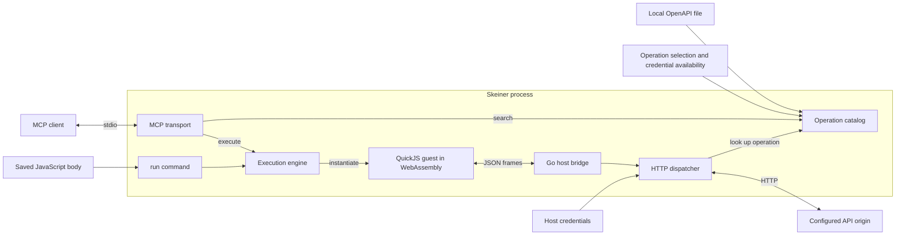
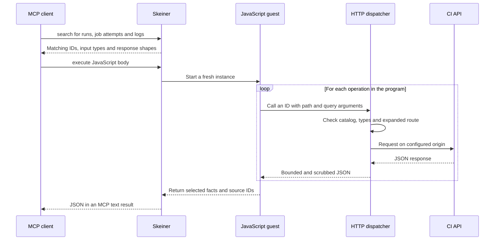

# Architecture

Skeiner gives a client two MCP tools over standard input and output. `search` describes the operations it can call. `execute` runs a JavaScript function body against those operations. The client can save the body and rerun it from the command line with `skeiner run`. Each run reads the API again.

## Components

At startup the Go host reads one local specification, resolves local references and builds a catalog from the supported operations, the owner's selection and the available credentials. A lexical index ranks IDs, paths, tags, summaries and parameters. An exact ID gets the highest search priority. Searching never contacts the API. Both entry points use the same catalog for dispatch, including when a program already knows an ID and skips discovery.

The host compiles the embedded QuickJS interpreter once per engine using wazero. Each execution gets a fresh WebAssembly instance, a heap and private in-memory streams. Program source, page data and accumulators live in that execution. The client owns saved source and any continuation it wants to use later.

## One investigation

Here a client asks for a failure in a CI run. Each read supplies an identifier for the next read. Only the evidence selected by the program appears in the final tool result.

The dispatcher constructs each URL from the configured base, template and typed arguments, attaches host credentials, and disables redirects and environment proxies. It checks path expansion against other declared routes, including routes excluded from the allowlist. Resource-level authorization, such as which projects a token can read, belongs to the upstream API.

The guest has no host filesystem mounts, environment or sockets. Host calls still undergo the same validation if the guest writes directly to its private streams. Separate limits bound guest memory, time, request count and response size. An execution error discards its local state. An upstream operation that already completed keeps its effects.

## Navigating the implementation

| Component | Responsibility |
| --- | --- |
| [Command](../cmd/skeiner) | Process configuration, preflight, stdio serving, saved programs and evaluation commands |
| [Catalog](../internal/catalog) | OpenAPI subset, operation selection, lexical search and route matching |
| [Transport](../internal/transport) and [service](../internal/service) | MCP tool schemas, dispatch callbacks and client-facing errors |
| [Sandbox](../internal/sandbox) | WebAssembly lifecycle, guest protocol, deadlines and continuation helper |
| [Dispatcher](../internal/dispatch) | Parameter encoding, credentials, upstream HTTP and JSON scrubbing |
| [Evaluator](../internal/eval) | Task driver, recorded upstream evidence and owner-defined grading |

For integration details, see the [OpenAPI reference](openapi.md), [JavaScript guide](sandbox.md) and [evaluation guide](evaluations.md).
